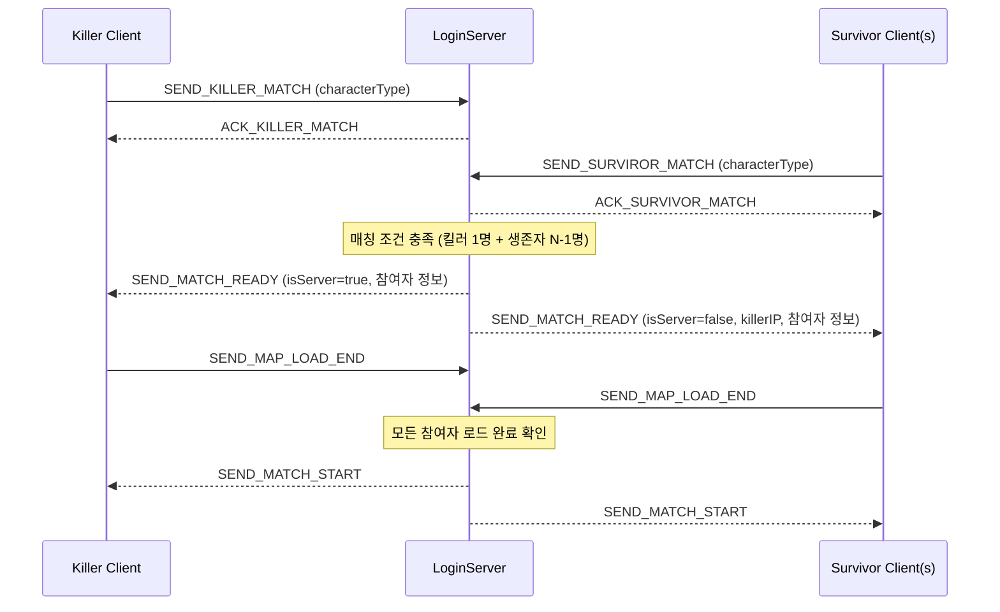

# LoginServer (DBDLoginServer)

담당자 : 변한빛

비대칭 멀티플레이어 게임(Dead by Daylight 스타일: **1 Killer vs N Survivors**)을 위한 **Windows IOCP 기반 로그인 · 로비 채팅 · 매칭 서버**입니다.

---

## 주요 기능

- **IOCP 비동기 TCP 네트워킹**
  - WinSock2 + Windows IOCP(`CreateIoCompletionPort`, `WSARecv`, `WSASend`)와 스레드 풀(`HThreadPool`, 기본 4스레드)을 이용한 비동기 I/O 처리
  - 논블로킹 소켓 및 `TCP_NODELAY`(Nagle 알고리즘 비활성화) 적용
- **비대칭 매칭 시스템 (1 Killer vs N-1 Survivors)**
  - 생존자(`m_survivorMap`)와 킬러(`m_killerMap`) 대기열을 분리 관리
  - 설정된 매칭 인원(`m_setMatchPlayer`, 기본값 `2`명) 충족 시 자동으로 매칭 성립
  - 매칭 성립 시 킬러를 호스트(`isServer = true`), 생존자를 클라이언트(`isServer = false`)로 지정하고 킬러 IP 및 참가자 캐릭터 정보를 전송(`SEND_MATCH_READY`)
  - 모든 참가자의 맵 로드 완료(`SEND_MAP_LOAD_END`)를 수신하면 게임 시작 패킷(`SEND_MATCH_START`) 전송
  - 매칭 대기/로딩 중 이탈자가 발생하면 방 전체에 매칭 취소(`SEND_MATCH_ABANDONED`) 통보
- **로비 채팅 및 서버 공지**
  - 접속한 모든 클라이언트에 채팅 메시지 브로드캐스트
  - Windows 콘솔(CP949) ↔ 네트워크 패킷(UTF-8) 인코딩 자동 변환(`HNetAPI`)
- **서버 IP 자동 조회 및 컬러 로깅**
  - 서버 시작 시 내부 IP(IPv4)와 외부 공인 IP(`api.ipify.org` 등) 자동 조회 및 출력
  - `fmt` 라이브러리를 활용한 로그 레벨별 컬러 출력 (`LOG_INFO`, `LOG_WARNING`, `LOG_ERROR`, `LOG_DEBUG`)
- **콘솔 관리자 명령어**
  - 별도 입력 스레드를 통해 서버 실행 중 실시간 상태 조회, 공지 전송, 매칭 인원 변경, 안전한 서버 종료 지원

---

## 개발 환경 및 의존성

| 항목 | 내용 |
| :--- | :--- |
| **언어** | C++20 (`stdcpp20`) |
| **OS / IDE** | Windows 10/11, Visual Studio 2022 (`v143` 플랫폼 도구 집합) |
| **네트워크** | WinSock2 (`ws2_32.lib`), IOCP |
| **직렬화** | Google Protocol Buffers (`proto3`, `ThirdParty/protobuf`) |
| **로깅** | `{fmt}` (`ThirdParty/fmt`) |

> 서드파티 라이브러리(`fmt`, `protobuf` 헤더/정적 라이브러리/DLL 및 `protoc.exe`)가 `ThirdParty/` 폴더에 포함되어 있습니다.

---

## 프로젝트 구조

```text
LoginServer/
├── LoginServer.sln                 # Visual Studio 솔루션 파일
├── .clang-format                   # 코드 포맷팅 설정
├── LoginServer/
│   ├── Main.cpp                    # 진입점 (Protobuf 초기화, 포트 5000 설정 및 서버 실행)
│   ├── pch.h / pch.cpp             # 프리컴파일드 헤더 및 로깅 매크로 정의
│   ├── DBDLoginServer.h / .cpp     # 서버 메인 라이프사이클 및 콘솔 입력 스레드 관리
│   ├── HNetwork.h / .cpp           # 싱글톤 네트워크 코어 (WinSock, Accept, 패킷 큐, Overlap 관리)
│   ├── HIocp.h / .cpp              # IOCP 핸들 및 워커 스레드 I/O 완료 처리
│   ├── HThreadPool.h / .cpp        # IOCP 워커 스레드 풀 (기본 4개)
│   ├── HSession.h / .cpp           # 클라이언트 세션 (AsyncRecv / AsyncSend)
│   ├── HSessionManager.h / .cpp    # 접속 세션 관리, 브로드캐스트, 연결 종료 처리
│   ├── HOverlap.h                  # OVERLAPPED 확장 구조체 (송수신 버퍼 및 상태 관리)
│   ├── HProtocol.h                 # 패킷 헤더 구조체 및 패킷 타입 열거형
│   ├── HPacketProcessor.h / .cpp   # 패킷 콜백 디스패처 및 Protobuf 직렬화/역직렬화
│   ├── HMatching.h / .cpp          # 킬러/생존자 매칭 큐 및 매칭 방 상태 관리
│   ├── HCommand.h / .cpp           # 서버 콘솔 슬래시 명령어 처리
│   ├── HNetAPI.h                   # 문자열 인코딩 변환 유틸리티 (CP949 ↔ UTF-8, Unicode)
│   ├── HSingleton.h                # CRTP 기반 싱글톤 템플릿
│   ├── HConvention.h               # Init() / Release() 인터페이스
│   └── Packet.pb.h / .cc           # Protobuf 생성 코드 (Pre-Build 시 자동 복사)
└── ThirdParty/
    ├── fmt/                        # fmt 라이브러리 (include, lib)
    └── protobuf/                   # Protobuf (Packet.proto, protoc.exe, include, lib, dll)
```

---

## 매칭 흐름



- 매칭 성립 전 `SEND_MATCH_CANCEL`을 보내면 대기열에서 제거되며 `ACK_MATCH_CANCEL`로 응답합니다.
- 매칭 성립 후 로드 완료 전 이탈(연결 끊김)이 발생하면 남은 참가자 전원에게 `SEND_MATCH_ABANDONED`가 전송됩니다.

---

## 패킷 프로토콜

### 패킷 구조 (`HProtocol.h`)

1바이트 정렬(`#pragma pack(push, 1)`)을 사용하며, 고정 8바이트 헤더 뒤에 Protobuf 직렬화 데이터가 이어집니다.

| 필드 | 타입 | 크기 | 설명 |
| :--- | :--- | :--- | :--- |
| `ph.len` | `int` | 4 bytes | 헤더 + 페이로드 전체 길이 |
| `ph.type` | `HPACKET_TYPE` (`UINT16`) | 2 bytes | 패킷 종류 |
| `ph.time` | `short` | 2 bytes | 패킷 전송 시간 |
| `msg` | `char[1024]` | 최대 1024 bytes | Protobuf 직렬화 페이로드 |

### 패킷 타입 (`HPACKET_TYPE`)

| 패킷 타입 | 방향 | Protobuf 메시지 | 설명 |
| :--- | :---: | :--- | :--- |
| `CHAT_MSG` | C ↔ S | `HProtocol::Chat` | 채팅 메시지 송수신 및 전체 브로드캐스트 |
| `SEND_SURVIROR_MATCH` | C → S | `HProtocol::MatchPlayer` | 생존자 매칭 요청 (캐릭터 타입 포함) |
| `ACK_SURVIVOR_MATCH` | S → C | - | 생존자 매칭 대기열 등록 응답 |
| `SEND_KILLER_MATCH` | C → S | `HProtocol::MatchPlayer` | 킬러 매칭 요청 (캐릭터 타입 포함) |
| `ACK_KILLER_MATCH` | S → C | - | 킬러 매칭 대기열 등록 응답 |
| `SEND_MATCH_CANCEL` | C → S | - | 매칭 대기 취소 요청 |
| `ACK_MATCH_CANCEL` | S → C | - | 매칭 대기 취소 응답 |
| `SEND_MATCH_READY` | S → C | `HProtocol::MatchReady` | 매칭 성립 통보 (호스트 여부, 킬러 IP, 캐릭터 목록) |
| `SEND_MATCH_ABANDONED` | S → C | - | 이탈자 발생으로 인한 매칭 강제 종료 통보 |
| `SEND_MAP_LOAD_END` | C → S | - | 클라이언트 맵 로딩 완료 알림 |
| `SEND_MATCH_START` | S → C | - | 전원 준비 완료 후 게임 시작 통보 |

### 캐릭터 타입 (`ECharacterType`)

- `0`: `NONE`
- `1`: `MEG`
- `2`: `DRACULA`

### Protobuf 파일 재생성

`ThirdParty/protobuf/Packet.proto`를 수정한 경우 해당 폴더에서 아래 명령으로 C++ 코드를 다시 생성합니다.

```powershell
cd ThirdParty/protobuf
.\protoc.exe --cpp_out=. Packet.proto
```

---

## 빌드 및 실행 방법

1. `LoginServer.sln`을 **Visual Studio 2022**로 엽니다.
2. 빌드 구성을 **`Debug | x64`**로 선택합니다.
   - `Debug | x64` 구성에는 사전/사후 빌드 이벤트가 설정되어 있습니다.
     - **Pre-Build**: `ThirdParty/protobuf/Packet.pb.{cc,h}`를 `LoginServer/`로 자동 복사
     - **Post-Build**: `ThirdParty/protobuf/libprotobufd.dll`을 `output/debug/`로 자동 복사
   - 출력 경로: `output/debug/`
3. 빌드 후 실행하면 기본 포트 **`5000`**으로 서버가 시작됩니다.
   - 포트 변경: `LoginServer/Main.cpp`의 `server.SetServerPort(5000);` 수정
   - 디버그 상세 로그 활성화: `LoginServer/pch.h`의 `// #define DEBUG_PRINT` 주석 해제

> **참고**: `Release | x64` 구성을 사용할 경우 `LoginServer.vcxproj`에 `protobuf` include/lib 경로, C++20 표준, Precompiled Header 및 `libprotobuf.dll` 복사 설정을 추가로 맞춰주어야 합니다.

---

## 콘솔 명령어

서버 실행 중 콘솔에 `/`로 시작하는 명령어를 입력할 수 있습니다.

| 명령어 | 설명 |
| :--- | :--- |
| `/help` | 사용 가능한 명령어 목록 출력 |
| `/list` | 현재 접속 중인 클라이언트 목록 출력 (Socket, IP, Port) |
| `/matchlist` | 현재 매칭 대기열(생존자/킬러) 및 성립된 매칭 방 목록 출력 |
| `/maxplayer <인원 수>` | 매칭 최대 인원 설정 (2명 이상, 변경 시 전체 공지 전송) |
| `/say <메시지>` | 접속 중인 모든 클라이언트에게 `[Server]` 공지 메시지 전송 |
| `/ovlist` | 현재 활성화된 `HOverlap` 객체 목록 및 송수신 바이트 위치 출력 |
| `/exit` | 서버 안전 종료 |
